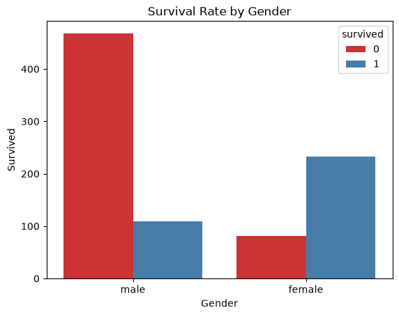
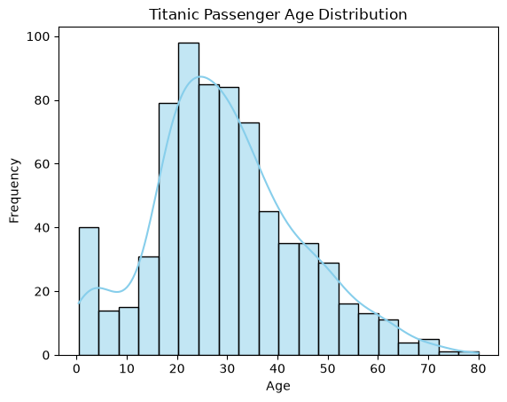
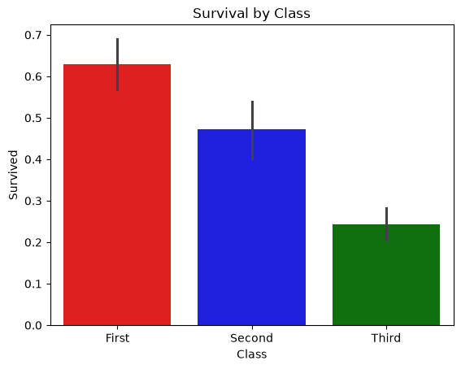

# 🚢 Titanic Data Visualization & EDA

A beginner-friendly data analysis project that explores the famous **Titanic dataset** (from Seaborn) using **Python**, with charts and Exploratory Data Analysis (EDA) to understand who survived and why.

---

## 📌 Project Overview

On April 15, 1912, the Titanic sank after hitting an iceberg. This project looks at passenger data to answer questions like:

- 👩 Did women survive more than men?
- 🎫 Did ticket class affect survival?
- 👶 Did age matter?
- 💰 Did paying a higher fare help?

---

## 🛠️ Tools & Libraries

| Tool | Purpose |
|------|---------|
| 🐍 Python | Programming language |
| 🐼 Pandas | Data handling and cleaning |
| 🔢 NumPy | Numerical operations |
| 🌊 Seaborn | Dataset and statistical charts |
| 📈 Matplotlib | Plot customization |
| 📓 Jupyter Notebook / VS Code | Running the code |

---

## 📂 Dataset

The dataset is loaded directly from Seaborn:

```python
import seaborn as sns
titanic = sns.load_dataset("titanic")
```

### 🧾 Key Columns

| Column | Meaning |
|--------|---------|
| `survived` | 0 = No ❌, 1 = Yes ✅ |
| `pclass` / `class` | Ticket class (First, Second, Third) 🎫 |
| `sex` | Male 👨 / Female 👩 |
| `age` | Age of passenger 🎂 |
| `sibsp` | Siblings / spouses aboard 👫 |
| `parch` | Parents / children aboard 👨‍👩‍👧 |
| `fare` | Ticket price paid 💷 |
| `embarked` | Port of boarding ⚓ |
| `deck` | Cabin deck 🏠 |

---

## 🔍 Exploratory Data Analysis (EDA)

Steps followed in this project:

1. 👀 **Look at the data**: `head()`, `shape`, `info()`
2. 📊 **Summary statistics**: `describe()`
3. ❓ **Check missing values**: `isnull().sum()`
4. 🔁 **Check duplicates**: `duplicated().sum()`
5. 📉 **Univariate analysis**: one column at a time
6. 🔗 **Bivariate analysis**: two columns together
7. 🚨 **Outlier detection**: especially in `fare`
8. 💡 **Draw insights** from the patterns found

### ⚠️ Data Quality Notes
- `age` has missing values 🎂
- `deck` has many missing values 🏠
- `embarked` has a couple of missing values ⚓

---

## 📊 Visualizations

### 1️⃣ Survival by Class 🎫
A bar plot showing the survival rate for each ticket class.

```python
sns.barplot(
    data=titanic,
    x="class",
    y="survived",
    hue="class",
    legend=False,
    palette=["red", "blue", "green"]
)
plt.title("Survival by Class")
plt.xlabel("Class")
plt.ylabel("Survival Rate")
plt.show()
```

**Finding:** First class had the highest survival rate (about 63%), then Second (about 47%), then Third (about 24%).

### 2️⃣ Chart 2 📈
> Add the name, code, and a short description of your second chart here.

### 3️⃣ Chart 3 📉
> Add the name, code, and a short description of your third chart here.

---
## Screen Shots :

### Chart 1:


### Chart 2:


### Chart 3:



## 💡 Key Insights

- 👩 **Women** survived at a much higher rate than men
- 🥇 **First class** passengers had better survival chances than Third class
- 👶 **Children** had a higher chance of survival
- 💰 **Higher fares** are linked to higher survival, mostly because they reflect First class
- ❓ Missing data in `age` and `deck` needs careful handling

---

## 🚀 How to Run

1. 📥 Clone or download this project
2. 📦 Install the required libraries:
   ```bash
   pip install pandas numpy seaborn matplotlib
   ```
3. 📓 Open the notebook in Jupyter or VS Code
4. ▶️ Run all cells

---

## 📁 Project Structure

```
📦 titanic-visualization
 ┣ 📓 titanic_analysis.ipynb
 ┗ 📄 README.md
```

---

## 🔮 Future Improvements

- 🧹 Fill missing `age` values and clean the data
- 🤖 Build a machine learning model to predict survival
- 🎨 Add more charts such as heatmaps and pair plots
- 🌐 Create an interactive dashboard

---

## 🙌 Acknowledgements

- 🌊 Dataset provided by the **Seaborn** library
- 📚 Original data from the Titanic passenger records

---

⭐ If you found this project helpful, give it a star!