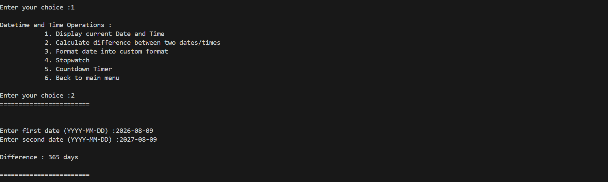
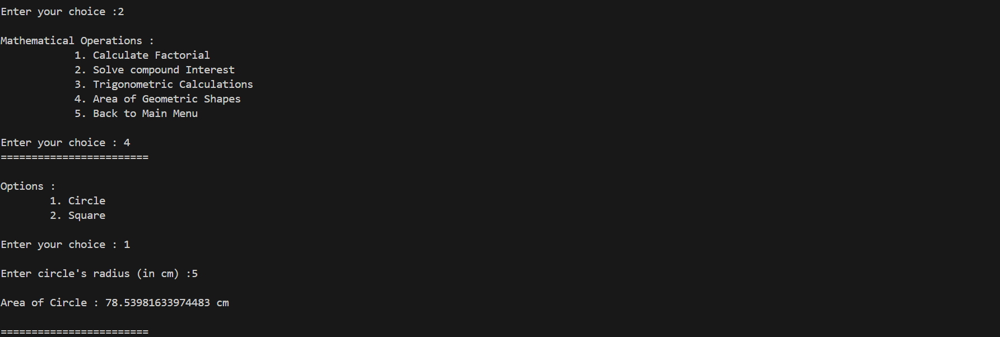
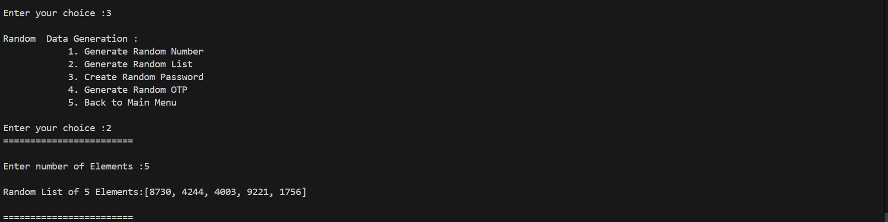
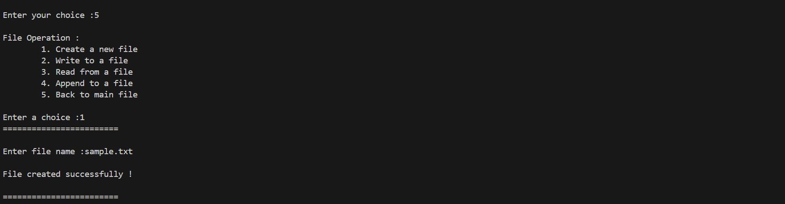

# 🧰 Multi-Utility Toolkit (PR-7)


A modular, CLI-driven **Multi-Utility Toolkit** built in Python. This project demonstrates Python package structure, sub-module imports, and interaction with Python standard libraries (`math`, `datetime`, `random`, `uuid`) alongside custom file operations.

---

## 🌟 Key Features

| Category | Description | Supported Operations |
| :--- | :--- | :--- |
| 🕒 **Datetime & Time** | Date & Time manipulations | Current time, Date difference, Formatting, Stopwatch, Countdown timer |
| 🧮 **Mathematical** | Math & Geometry calculations | Factorial, Compound Interest, Trigonometry (`sin`, `cos`, `tan`), Area of Circle/Square |
| 🎲 **Random Data** | Random generators | Random range numbers, Random list generator, Secure Passwords, 4-digit OTPs |
| 🆔 **UUID Generator** | Identifier generation | Unique UUID v4 generation |
| 📁 **File Operations** | Custom I/O handling | Create file, Write text, Read file content, Append data |
| 🔍 **Module Explorer** | Reflection & Inspection | Inspect internal attributes using `dir()` for `math`, `datetime`, `random`, `uuid` |

---

## 📁 Directory Structure

```text
PR-7/
│
├── moduler_packages.py        # Main entry point (Interactive CLI menu)
├── README.md                  # Project documentation
│
└── package/                   # Custom Python package
    ├── __init__.py            # Package initialization & exports
    ├── datetime_operation.py  # Date, time, stopwatch & countdown logic
    ├── dir.py                 # Module attribute explorer using dir()
    ├── file_operations.py     # Custom file I/O operations
    ├── mathematical_operation.py # Factorial, interest, trigonometry & geometry
    ├── random_operation.py    # Random number, password & OTP generators
    └── uuid_operation.py      # UUID v4 generator
```

---

## 🚀 Quick Start

### Prerequisites
- Python 3.8 or higher installed on your system.

### Running the Application
1. Open your terminal or command prompt.
2. Navigate to the project folder:
   ```bash
   cd D:/Python/projects/PR-7
   ```
3. Run the main script:
   ```bash
   python moduler_packages.py
   ```

---

## 💻 Usage Example

Upon running `moduler_packages.py`, you will be greeted with the main interactive menu:

```text
====Welcome to the Multi-Utility Toolkit====

Options :
    1. Datetime and Time Operations
    2. Mathematical Operations
    3. Random Data Generation
    4. Generate Unique Indentifiers (UUID)
    5. File Operations (Custom Module)
    6. Explore Module Attributes (dir())
    7. Exit

Enter your choice : 
```

Simply select an option by typing its corresponding number and pressing `Enter`.

## Screen shots :

### Date and Time :


### Mathemetics :


### Random :


### File Operator :


---

## 📦 Package Architecture

The project leverages Python's modular import system via `package/__init__.py`:

```python
from .datetime_operation import dateandtime
from .file_operations import file_handling
from .mathematical_operation import mathemetics
from .random_operation import numbers
from .dir import data
from .uuid_operation import id
```

This exposes clean, top-level function calls directly through the `package` module, enabling streamlined imports in `moduler_packages.py`.

---

## 📝 License & Acknowledgments

- **Project**: PR-7 Modular & Packages Assignment
- Built with standard Python library modules (no third-party dependencies required).
