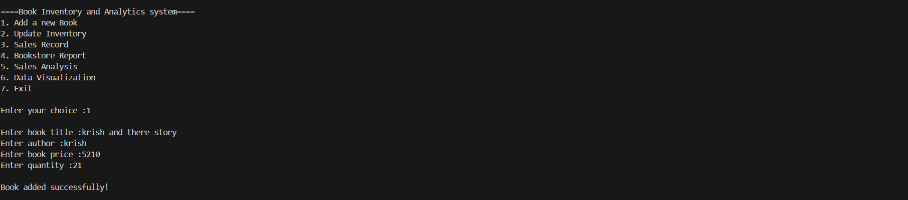
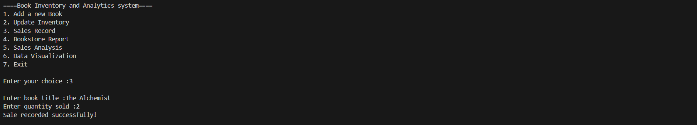
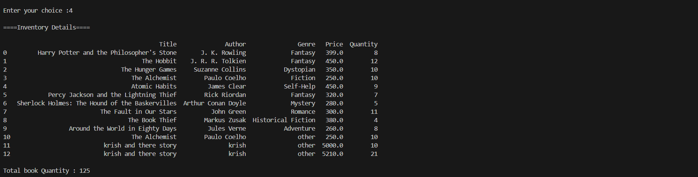
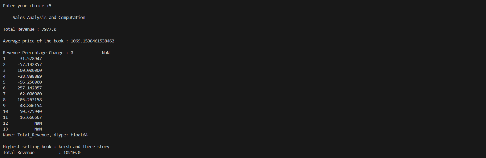
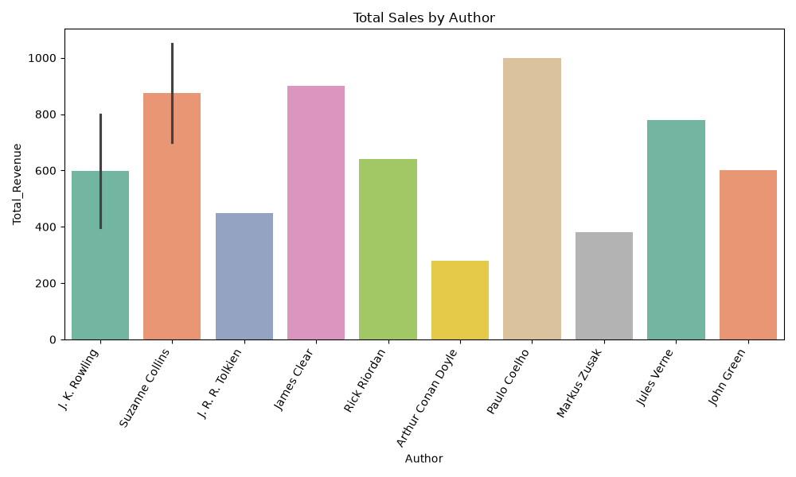

# 📚 Bookstore Inventory and Analytics System

<p align="center">
  <b>📖 Manage Books • 💰 Record Sales • 📊 Analyze Data</b>
</p>

---

## 🌟 About the Project

The **Bookstore Inventory and Analytics System** is a Python-based project that helps manage book inventory, record sales, generate reports, perform sales analysis, and visualize data using charts.

This project uses **Python, NumPy, Pandas, Matplotlib, and Seaborn** to perform inventory management and data analysis operations. Book and sales records are stored in CSV files, so the data can be saved and used again later.

---

## ✨ Features

📌 **1. Add a New Book**
- Add a book's title, author, price, and quantity.
- Automatically assign the genre as `other`.
- Save the new book details to the inventory CSV file.

📦 **2. Update Inventory**
- Update the available stock of an existing book.
- Display a message if the book is not found.

🛒 **3. Record a Sale**
- Record the title and quantity of books sold.
- Check whether sufficient stock is available.
- Automatically reduce the inventory quantity.
- Calculate total revenue from the sale.
- Save the sale details with the current date.

📋 **4. Generate Bookstore Report**
- Display all book inventory details.
- Calculate the total quantity of books in stock.
- Display the sales report.
- Calculate total revenue from recorded sales.

📈 **5. Sales Analysis and Computation**
- Calculate total revenue using NumPy.
- Calculate the average book price.
- Calculate the percentage change in revenue.
- Identify the book with the highest listed price in the inventory analysis.

📊 **6. Data Visualization**

Create different charts to understand the bookstore's data easily.

- 📊 **Bar Chart:** Compare sales revenue by author.
- 📉 **Line Chart:** View revenue trends over recorded dates.
- 🥧 **Pie Chart:** Intended to display revenue share by book genre.
- 🔥 **Heatmap:** Compare book prices and quantities sold.

---

## 🛠️ Technologies Used

| Technology | Purpose |
|---|---|
| 🐍 Python | Main programming language |
| 🔢 NumPy | Numerical calculations |
| 🐼 Pandas | Reading, updating, and analyzing CSV data |
| 📊 Matplotlib | Creating charts and graphs |
| 🎨 Seaborn | Creating statistical visualizations |
| 📄 CSV | Storing inventory and sales records |

---

## 📁 Project Structure

```text
Bookstore_Project/
│
├── bookstore.py
│
├── Practice_test/
│   ├── inventory.csv
│   └── sales.csv
│
└── README.md
```

**File descriptions:**

- `bookstore.py` — Contains the main Python program and `Bookstore` class.
- `inventory.csv` — Stores book information and available stock.
- `sales.csv` — Stores recorded sales, quantities sold, dates, and revenue.
- `README.md` — Explains the project and how to use it.

*Note: `bookstore.py` is an example filename. Use your actual Python filename if it is different.*

---

## 📄 CSV File Structure

### 📚 `inventory.csv`

This file stores the details of books available in the bookstore.

| Title | Author | Genre | Price | Quantity |
|---|---|---|---:|---:|
| Python Basics | John Smith | Education | 350 | 10 |
| Data Science | Alex Brown | Technology | 500 | 8 |
| Mystery Novel | David Lee | Fiction | 250 | 12 |

### 💰 `sales.csv`

This file stores the details of completed sales.

| Date | Title | Quantity Sold | Total_Revenue |
|---|---|---:|---:|
| 2026-10-15 | Python Basics | 2 | 700 |
| 2026-10-16 | Data Science | 1 | 500 |

*The example records above are sample data. Make sure the actual CSV column names match the names used in your Python code.*

---

## ⚙️ Installation and Setup

### Step 1️⃣: Install Python

Install Python on your computer if it is not already installed.

### Step 2️⃣: Install Required Libraries

Open the VS Code terminal and run:

```bash
pip install numpy pandas matplotlib seaborn
```

### Step 3️⃣: Create the Project Folders

Create the `Practice_test` folder and place both CSV files inside it.

### Step 4️⃣: Run the Program

Run the following command from your project directory:

```bash
python bookstore.py
```

---

## 🖥️ How to Use the Program

After running the program, the following menu appears:

```text
====Book Inventory and Analytics system====
1. Add a new Book
2. Update Inventory
3. Sales Record
4. Bookstore Report
5. Sales Analysis
6. Data Visualization

Enter your choice:
```

Select an option by entering its corresponding number.

| Choice | Operation |
|---:|---|
| 1 | Add a new book |
| 2 | Update book stock |
| 3 | Record a sale |
| 4 | View the bookstore report |
| 5 | Perform sales analysis |
| 6 | Generate data visualizations |

### 💡 Example: Recording a Sale

```text
Enter your choice : 3
Enter book title : Python Basics
Enter quantity sold : 2

Sale recorded successfully!
```

If the stock is insufficient, the program displays a message instead of recording the sale.

---

## 🧠 Python Concepts Used

This project helps practice the following concepts:

- 🏗️ **Classes and Objects** — Organize bookstore operations inside the `Bookstore` class.
- 🔧 **Methods** — Separate tasks into methods such as `add_book()`, `record_sale()`, and `generate_report()`.
- 🔀 **Conditional Statements** — Use `if`, `elif`, and `else` to handle menu choices and stock checks.
- 📂 **File Handling** — Read and save data using CSV files through Pandas.
- 🧮 **Data Analysis** — Calculate totals, averages, and percentage changes.
- 📊 **Data Visualization** — Represent information using bar, line, pie, and heatmap charts.

---

## 🚀 Future Improvements

Possible improvements for the project:

- 🔍 Search for books by title or author.
- 🗑️ Delete a book from inventory.
- 🧾 Generate a detailed sales report by month.
- 🏷️ Allow users to select a book genre.
- 🛡️ Add input validation and exception handling.
- 🔁 Add a continuous menu loop so users can perform multiple operations without restarting the program.
- 📊 Correct and improve the genre-based revenue pie chart.
- 🏆 Identify the best-selling book based on the actual quantity sold or revenue.

---
## Screen Shots :

### Add Entry :


### Update Inventory :


### Sales Records :


### Report :


### Sales Analysis :


### data visualization :


## 🎯 Project Objective

The main objective of this project is to practice Python programming and data analysis by building a practical bookstore management application.

It combines inventory management, CSV file operations, numerical computation, and data visualization in one project.

---

<p align="center">
  <b>📚 Learn • 💻 Build • 📊 Analyze • 🚀 Improve</b>
</p>

⭐ **Thank you for checking out my Bookstore Inventory and Analytics System!**
